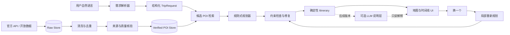

# 03. 系统架构

## 1. 逻辑架构

## 2. 模块职责

### 需求解析器

当前基础规则解析器直接输出 `ParsedTripRequest`。未来 LLM 解析器先输出不可信的 `TripRequestDraft v1`，经服务端 Schema、证据和 POI 白名单校验后才规范化为 `ParsedTripRequest`：

- 硬约束：天数、日期、必去、避开、时间范围、明确无障碍要求。
- 软偏好：兴趣、节奏、室内外偏好、餐饮偏好。
- 缺失项：没有提供且系统不得猜测的信息。
- 假设项：例如默认从 Flinders Street Station 出发。

解析器不得把不确定内容自动变成硬约束。

### POI 检索器

- 只读取达到最低准入标准的 POI。
- 先用硬条件过滤，再按兴趣、位置和数据质量排序。
- 返回事实字段、AI 推断字段和来源状态，不把它们混在一起。

### 规则式规划器

- 按区域聚类每天的地点。
- 决定路线顺序并插入游览、交通、用餐和缓冲时间。
- 计算预算、距离、结束时间和跨天重复。
- 数据不足时返回未知，不生成伪精确值。

### 约束检查器

- 验证开放时间、时间重叠、预算、重复、范围、必去／避开和每日结束时间。
- 尝试有限次确定性修复。
- 修复失败时返回可理解原因，不让 LLM 强行补齐。

### LLM 说明层

- 把确定性行程写成自然、简洁的中文。
- 解释地点为何匹配兴趣以及当前限制。
- 不得新增、删除或改变 POI、时间、费用和来源事实。

### 局部重新规划器

- 冻结其他日期和未被替换的活动。
- 在目标时间槽附近寻找可行替代项。
- 重新计算前后交通、费用和后续时间线。
- 保存替换前完整快照，以支持最多 20 步的全局 LIFO 撤销。

## 3. 推荐的首版技术形态

当前已部署版本冻结为纯前端、低运维方案：

- 前端：React + TypeScript + Vinext/Vite 响应式单页。
- 地图：根据 POI 坐标绘制的示意图，不使用第三方地图 SDK，也不宣称导航路线。
- 规划：浏览器内纯函数规则引擎，相同输入、数据版本和规划器版本得到相同结果。
- 数据：40 条静态 JSON 规范化快照；原始 CSV 和元数据离线保存。
- 测试：Vitest 规则测试、原始数据逐条匹配、真实浏览器交互验收。
- LLM 与服务端：当前不接入，不包含 API Key；接口与验证边界已冻结在 [`10_LLM_API_CONTRACT.md`](10_LLM_API_CONTRACT.md)，后续仍需对供应商、部署、成本和中国境内可达性做 L4 决策。

如果后续目标岗位明确要求 Java/Spring，再把已经验证过的规划核心迁移为 Spring Boot 服务；不应在第一版同时承担前后端、全国数据和生产部署复杂度。

## 4. 核心接口草案

以下接口是后续服务端版本的候选边界，当前尚未实现 HTTP API：

### `POST /api/trips/parse`

- 输入：用户原始需求。
- 输出：已校验的 `TripRequestDraft v1`、规范化 `ParsedTripRequest`、决策、问题和提醒。

WorkBuddy 继续托管纯静态网页；该接口必须部署在独立 HTTPS 服务中，密钥只存在服务端。网页收到已规范化请求后，首期仍可调用浏览器内现有 `planTrip()`。

### `POST /api/itineraries/generate`

- 输入：确认后的 `TripRequest`。
- 输出：确定性行程、检查结果、未核实字段。

### `POST /api/itineraries/{id}/replace`

- 输入：`day_id`、`slot_id`、可选替换理由。
- 输出：替换后的目标日期、变更摘要和撤销 token。

### `POST /api/itineraries/{id}/undo`

- 输入：撤销 token。
- 输出：恢复后的目标日期。

### `GET /api/pois/{id}`

- 输出：事实、推断、来源和图片署名。

## 5. 数据边界

### 来源事实 `facts`

- 官方名称、地址、坐标和官网。
- 官方营业时间、价格、预约要求和无障碍信息。
- 明确的关闭或季节状态。

### 确定性派生 `computed`

- 两点距离、区域、时间槽开放判断。
- 当日费用、重复、冲突和路线顺序。
- 有真实路由服务时的交通结果；否则必须标记估算方法。

### AI 推断 `inferences`

- 兴趣标签、雨天友好度、建议停留时间。
- 中文摘要和推荐理由。
- 每项记录模型、提示词版本、生成时间和人工审核状态。

## 6. 失败与降级

| 情况 | 行为 |
|---|---|
| LLM 不可用 | 用户改用结构化表单；规则规划仍可工作 |
| 天数缺失 | 保留原输入和上一次成功行程，询问 1／2／3 天；未补充前不调用规划器 |
| 日期缺失 | 不判断特定日期开放状态；全部动态结论标记待确认 |
| 路由服务不可用 | 使用有说明的距离估算，不伪造精确公交时间 |
| 图片缺失 | 使用类别占位图 |
| 动态字段过期 | 保留 POI，但标记 stale 并提示出发前核实 |
| 约束无解 | 保留原需求，解释冲突并建议最小放宽项 |
| 替换无候选 | 不修改原行程，显示失败原因 |

## 7. 安全与隐私

- 所有第三方密钥仅存服务端环境变量。
- 日志默认不记录完整自由文本中的个人信息。
- 不要求用户登录或提交身份证、护照、支付信息。
- 对外链接使用白名单协议并防止不安全跳转。
- 数据采集任务设置清晰 User-Agent、速率限制、重试和来源日志。
