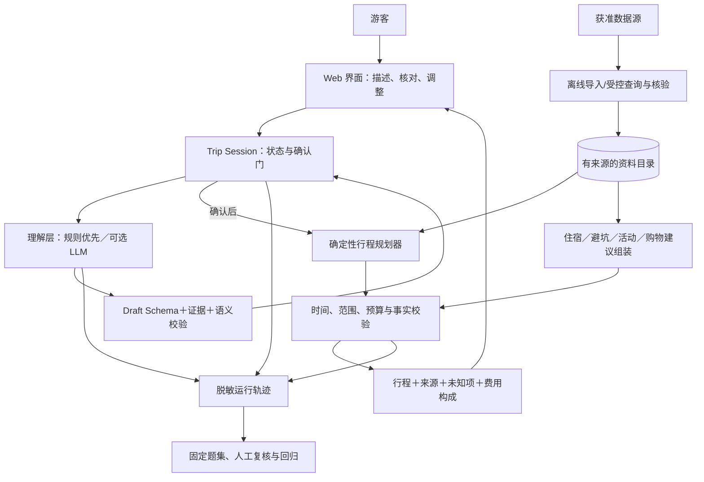

# 墨尔本旅游：现状架构与简历项目化框架

日期：2026-09-27  
状态：只读梳理与目标框架；尚未重构、接入新数据、运行新评测或发布。此文聚焦**结构和职责**，30 题及产品功能细项见[下一轮改造与测评计划](/Users/tako404/Desktop/studying/tongyong/秋招学习/墨尔本旅游/docs/38_NEXT_ITERATION_AND_EVALUATION_PLAN.md)。

## 1. 先定项目定位

这个项目当前解决的是：第一次来墨尔本的中文游客，用自然语言说明 1–3 天的偏好和限制，核对条件后得到可调整的行程。它已有真实来源的景点数据、受约束的输入理解、确定性排程与换点；后续想补酒店属性、交通避坑、季节活动、行李购物和分项费用估算。目标是成为**可独立复现、可审查、可测评、能展示取舍**的旅行规划项目，而不只是一个能打开的网页。不能把尚未实现的多 Agent、实时酒店价格或用户流量写成成果。

本轮建议的主形态是**模块化单体（modular monolith）＋有来源的资料层＋确定性规划/校验**。AI 继续处理其有价值而可校验的环节。多 Agent 保留实验入口，由同题测评决定是否值得引入。

## 2. 目前实际是什么结构

```text
游客输入 → 浏览器规则解析 → 条件不足时可尝试云模型抽取
                           → Draft 版本/Schema/原文证据/语义校验
         → 用户核对并确认 → 浏览器内 planTrip()
         ← 40 个 POI、门票及交通离线快照
         → 约束检查、部分费用披露、逐日行程
         → 单点替换与最多 20 步撤销
```

| 层 | 已有证据 | 当前结构问题 |
|---|---|---|
| 用户入口与状态 | [页面主流程](/Users/tako404/Desktop/studying/tongyong/秋招学习/墨尔本旅游/site/app/page.tsx:333)做解析、确认、生成和换点；行程状态在页面内。 | `page.tsx` 约 2964 行，展示、状态转换和接线交织；刷新后没有持久行程。先按职责拆清，再决定是否需要持久化。 |
| 理解层 | [编排器](/Users/tako404/Desktop/studying/tongyong/秋招学习/墨尔本旅游/site/app/lib/nlu-orchestrator.ts:116)校验模型 Draft，不通过整次回退规则；[规则优先门槛](/Users/tako404/Desktop/studying/tongyong/秋招学习/墨尔本旅游/site/app/lib/interpretation-tier.ts:111)控制何时调用模型。 | LLM 只理解输入，不选景点或自主调用多个旅行工具；目前不能称为多 Agent。 |
| 规划与预算 | [规划器](/Users/tako404/Desktop/studying/tongyong/秋招学习/墨尔本旅游/site/app/lib/planner.ts:1181)负责排程、约束、替换和部分费用；代码约 2885 行。 | 一个文件承担解析、类型、排程、价格与替换；酒店、餐饮等未覆盖费用不能形成可信的整趟总价。 |
| 资料 | [数据来源记录](/Users/tako404/Desktop/studying/tongyong/秋招学习/墨尔本旅游/data/SOURCES.md:3)和[导入脚本](/Users/tako404/Desktop/studying/tongyong/秋招学习/墨尔本旅游/scripts/import-poi-snapshot.mjs:15)已有 `raw → manifest → normalized → verified → planner JSON`，242 行官方数据精选 40 个 POI。 | 酒店、季节活动、交通避坑、购物/行李尚无同等级的字段、来源、许可、核验日和过期处理契约。 |
| 模型与发布 | 浏览器代码有[WorkBuddy 云模型适配](/Users/tako404/Desktop/studying/tongyong/秋招学习/墨尔本旅游/site/app/lib/cloud-llm-config.ts:22)；另保留 BFF/腾讯云实验适配器。 | [README](/Users/tako404/Desktop/studying/tongyong/秋招学习/墨尔本旅游/README.md:12)、[云服务记录](/Users/tako404/Desktop/studying/tongyong/秋招学习/墨尔本旅游/docs/33_CLOUD_SERVICE_LLM_ROUTE.md:139)及较新汇报的线上状态不一致。源码、发布包、当前公网版本需分别核对。公开模型额度防滥用仍有[未解项](/Users/tako404/Desktop/studying/tongyong/秋招学习/墨尔本旅游/docs/35_PUBLIC_LLM_ABUSE_CONTROL.md:133)。 |
| 测试与复现 | 已有 Vitest、POI 导入校验和局部 NLU 试验；[30 题计划](/Users/tako404/Desktop/studying/tongyong/秋招学习/墨尔本旅游/docs/38_NEXT_ITERATION_AND_EVALUATION_PLAN.md:43)尚待执行。 | 现有自动测试不等于开放任务质量测评；正式档案没有独立构建产物或 Git 历史，`site/package.json` 仍引用档案外的 `../../llm-gateway-kit`，[依赖与测试脚本](/Users/tako404/Desktop/studying/tongyong/秋招学习/墨尔本旅游/site/package.json:17)无法从这份档案单独安装复测。 |

注意：[旧架构文档](/Users/tako404/Desktop/studying/tongyong/秋招学习/墨尔本旅游/docs/03_ARCHITECTURE.md:72)仍把 LLM 写作未来能力。上表以当前代码和较新的记录为准；“当前线上具体是什么版本”仍需重新打开网页验证。

## 3. 参考资料如何用于本项目

| 参考 | 借鉴点 | 不照搬的部分 |
|---|---|---|
| [花海：项目完整链路](/Users/tako404/Desktop/studying/tongyong/秋招学习/花海牛客经验贴/原页备份/01_正文转录.txt:58)、[Agent 选型](/Users/tako404/Desktop/studying/tongyong/秋招学习/花海牛客经验贴/原页备份/11_正文转录.txt:18) | 说清真实游客问题、输入到结果的完整链、失败路径，以及为什么用规则/workflow/Agent。 | 不为技术名词硬加 RAG、向量库或多 Agent。 |
| [灵犀智服阅读版](/Users/tako404/Desktop/studying/tongyong/秋招学习/智能客服Agent/灵犀智服_阅读版.txt:207) | 借鉴“入口/编排 → 决策与组件 → 稳定接口 → 数据与外部服务”的职责和依赖方向；保留组件可替换接口。 | 它是飞书页面转录，[ZIP 源码未取得](/Users/tako404/Desktop/studying/tongyong/秋招学习/飞书资料归档说明.md:18)。不能声称我们运行了它，也不复制其十个 Maven 模块、PGVector/Redis/MCP 名词或模板性能数字。 |
| [CrewAI Trip Planner](https://github.com/crewAIInc/crewAI-examples/tree/main/crews/trip_planner) | [编排](https://github.com/crewAIInc/crewAI-examples/blob/main/crews/trip_planner/main.py)、角色、任务和工具分文件。 | 仓库已归档；示例没有足够的来源校验/测评/状态证据，不能照搬其“实时价格”等提示词。 |
| [LangChain Travel Planner Workshop](https://github.com/langchain-samples/travel-planner-deepagents-workshop) | 专项任务、人工确认、工具轨迹与同题评测的结构。 | [示例代码](https://github.com/langchain-samples/travel-planner-deepagents-workshop/blob/main/agents/travel_planner/agent.py)使用离线模拟检索、价格和预订，不是可直接接入的真实旅游数据。 |
| [Azure AI Travel Agents](https://github.com/Azure-Samples/azure-ai-travel-agents) | 借鉴[界面、编排 API、工具服务](https://github.com/Azure-Samples/azure-ai-travel-agents/tree/main/packages)的接口边界和运行观测。 | 三套编排、多语言服务及容器体系对当前 1–3 天墨尔本项目过重。 |

以上 GitHub 页面仅作本次（2026-09-27）的架构阅读，没有克隆、运行或证明其功能适合本项目。灵犀是教学材料，不是我们的代码基线。

## 4. 建议的目标结构



### 模块和输入输出

| 模块 | 只负责什么 | 关键契约与失败状态 |
|---|---|---|
| `web` / `trip-session` | 用户输入、条件来源、确认、重新编辑、换点/撤销；控制“确认前不规划”。 | `TripSession` 记录当前草稿、已确认版本、数据版本及最近成功行程。输入变化使旧确认失效；失败保留上次成功结果。先明确是否需要跨刷新保存，再选本地或服务端状态。 |
| `interpretation` | 本地规则或可选模型把文字转成结构化草稿；不生成 POI、价格或路线事实。 | `TripRequestDraft → evidence/schema/semantic validator → ConfirmedTripRequest`；超时或不合格整次回退，记录原因。 |
| `catalog` / `data-pipeline` | 按来源许可获取 POI、酒店属性、交通规则、活动、购物/行李资料，归一化并发布快照。 | 每个 `FactRecord` 至少有类型、值、来源 URL、取得方式/许可、核验时间、适用日期/区域、版本和 `verified/stale/unknown` 状态；缺资料时不伪造。酒店资料获取还需遵守[Tripadvisor 合作条款](https://developer-tripadvisor.com/partner/master-partnerships-terms-and-conditions/index.html)等来源限制。 |
| `planning` | 保留现有确定性筛选、排程、换点、撤销和硬约束检查，逐步把类型、预算、约束、替换从大文件拆开。 | 相同确认请求＋同一数据/规划器版本应可重现；输出 `PlanCandidate`、检查结果和不可验证项。重构前先冻结旧行为。 |
| `advice` / `cost` | 从已核实的资料和行程组装避坑、住宿、活动、行李购物；按分项依据计算费用。 | AI 可帮助选题和润色，但不能新增无来源事实；金额计算、时间匹配和预算判断由代码校验。酒店星级不推出房价，动态活动不保证余票。 |
| `quality` / `trace` | 执行硬检查、收集脱敏决策轨迹、重复运行固定任务集并回收坏案例。 | `TraceEvent` 包含会话/步骤 ID、资料与提示词版本、工具结果、失败/回退、耗时与成本；避免记录完整私人行程文本。离线报告区分旧功能回归、内容新增和 Agent 架构差异。 |

**目录只是建议的职责分区，不要求立刻搬文件：**

```text
site/app/features/          用户输入、核对、行程与换点组件
site/domain/interpretation/ 规则解析、Draft 契约、证据校验
site/domain/planning/       排程、约束、预算、替换与领域类型
site/domain/trip-session/   确认、版本和状态转换
site/data/catalog/          POI、酒店、交通、活动等可用快照
site/services/advice/       贴士、购物、行李与活动组装
scripts/data-pipeline/      各来源导入、权利/质量/时效核验
eval/                       固定题集、硬断言、人工评分与报告
docs/evidence/              设计取舍、AI 代码审查、坏案例与发布证据
```

## 5. 正常链路、失败链路和 Agent 边界

1. **正常链路**：输入 → 带证据的需求草稿 → 用户确认 → 从同一版本资料中选 POI/建议 → 确定性排程与费用计算 → 硬检查 → 展示来源和待确认项。输出要能解释“为什么安排/为什么没安排”。
2. **动态资料失败**：酒店/活动来源失效或过期时，主行程仍可从已核实 POI 生成；相应栏目标记资料缺失或过期，不把旧活动、旧票价补成当前事实。模型失败仍使用已验证的规则路径。
3. **修改链路**：变更偏好会使确认失效；换一个地点只重算受影响日期及汇总；失败不部分提交。每次处理保留数据版本和可复盘轨迹。
4. **AI/Agent 选型**：当前 40 个结构化 POI 和固定 1–3 天规则，不需要先建向量库或十个 Agent。若将来确实出现跨来源多步骤资料核对，先让一个有工具边界的 Agent 与当前 workflow 同题比较；只有多角色协作在质量上有清楚收益且成本/耗时可接受，才把多 Agent 放入主链。LLM 无论扮演什么角色，都不能越过用户确认与确定性约束。

## 6. 使它成为可核查简历项目的顺序

| 顺序 | 结构交付 | 验收证据 |
|---|---|---|
| A. 确定唯一工作仓库 | 说明正式档案与开发源目录的关系；将 `llm-gateway-kit` 作为可复现 workspace/包纳入，或去掉不需要的 BFF 依赖；从干净目录能安装、测试、构建。自此使用 Git 记录真实改动，不补造历史。 | clean checkout 的环境、命令、结果；依赖锁定；不含密钥/构建缓存。 |
| B. 校准文档与版本 | 重画“现状”架构图，标注源码、发布包、线上是否一致；决定保留还是归档实验 BFF/腾讯云路径。 | 当前网页实际构建标识、主链点击验证、准确 README、版本与回滚记录。 |
| C. 拆清模块并扩资料 | 先用既有测试冻结行为，再拆页面/规划器职责；沿 POI 管道给酒店、交通、活动、购物资料建立统一来源和时效契约。 | 重构前后同题回归；每类资料来源/许可/有效期、缺失处理；两个可复盘的坏案例。 |
| D. 加完整工程闭环 | 按需接入服务端受控数据查询、额度/超时/取消及脱敏轨迹；若纯离线快照已满足需求，保持静态简单形态。 | 失败注入、人工确认、预算覆盖说明、工具轨迹、浏览器端到端验收。 |
| E. 测评与项目展示 | 执行[30 题计划](/Users/tako404/Desktop/studying/tongyong/秋招学习/墨尔本旅游/docs/38_NEXT_ITERATION_AND_EVALUATION_PLAN.md:43)；用同数据/工具比较方案；记录自己怎样审 AI 代码，并制作真实过程视频。 | 原始记录、评分表、重复运行的波动/成本、代码审查与修复证据、网站及视频的实际可访问链接。 |

如果目标岗位主要考 Java/Spring 后端，可在上面链路稳定后评估**一个薄服务**是否提供真实价值，例如资料查询、任务轨迹与额度控制；不应仅为技术栈把现有规划器重写成微服务。具体岗位匹配需要对应真实 JD 再定。

## 7. 目前尚未作出的决策

- 酒店、活动、购物资料的授权和可用性未落定；[上一个计划](/Users/tako404/Desktop/studying/tongyong/秋招学习/墨尔本旅游/docs/38_NEXT_ITERATION_AND_EVALUATION_PLAN.md:34)已列核验入口。目标结构允许资料缺失，不把“网页能看”当成“可自动接 API”。
- 当前公网版本、缓存和模型额度控制需要复验，不能凭过时 README 或单次本地模型试验写简历成果。
- 是否引入后端、RAG 或多 Agent，需要明确用例、相同资料下的基线比较和可接受的成本；这些属于后续实施决策，不是本轮已完成的技术能力。
