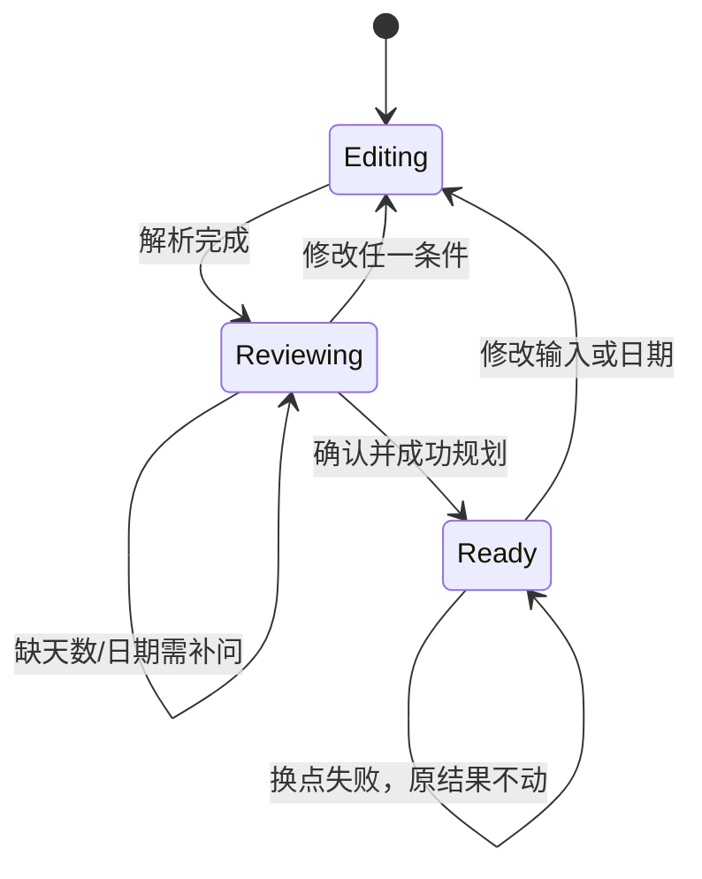

# 墨尔本旅游：输入、资料与页面契约（实施前规划）

日期：2026-09-28  
状态：设计稿；以下名称是职责和字段建议，尚未修改 Schema、页面、规划器或发布站点。与[现状基线及第一轮范围](/Users/tako404/Desktop/studying/tongyong/秋招学习/墨尔本旅游/docs/40_BASELINE_AND_FIRST_ITERATION_SCOPE.md)配套。灵犀智服仅借鉴“入口/编排 → 决策组件 → 稳定接口 → 数据/外部服务”的分层。

## 1. 先保留什么

现有 [ParsedTripRequest](/Users/tako404/Desktop/studying/tongyong/秋招学习/墨尔本旅游/site/app/lib/planner.ts:154)已有天数、日期文字、墨尔本当地起点、同行票型、预算、节奏和偏好；[TripRequestDraft v2](/Users/tako404/Desktop/studying/tongyong/秋招学习/墨尔本旅游/data/trip-request-draft-v2.schema.json:1)把模型输出限制为“抽取带原文证据的需求”。[页面](/Users/tako404/Desktop/studying/tongyong/秋招学习/墨尔本旅游/site/app/page.tsx:625)要求用户确认后才规划，[BudgetEnvelopeV2](/Users/tako404/Desktop/studying/tongyong/秋招学习/墨尔本旅游/site/app/lib/planner.ts:279)已能分开已知金额、未知项和预算结论。

因此第一轮只扩充少量**游客背景和费用假设**，并在既有行程结果旁增加来源可追的建议。不要重建另一套旅行请求或让 AI 绕过确认门。此文的 `TripBundle` 仅表示将来需一并提交/撤销的结果集合，不要求立刻更换当前代码类型。

## 2. 输入契约：新增项必须能由用户核对

| 字段/概念 | 现状 | 第一轮规划 | 验证和默认行为 |
|---|---|---|---|
| 开始日期 `dateText` | 已有可空日期；相对日期不自动换算。[日期处理](/Users/tako404/Desktop/studying/tongyong/秋招学习/墨尔本旅游/site/app/lib/planner.ts:807) | 继续使用经用户确认的 `YYYY-MM-DD` 作为开始日；行程末日由开始日＋天数计算。 | 缺日期仍可规划 POI，但只给通用准备清单，活动显示“补充出行日期”；“下个月”等先请用户确认具体日期。 |
| 墨尔本本地起点 `origin` | 已有住宿区域或具体起点。 | 保持“每日从哪里出发”的含义。 | 不把它用作“中国哪座城市出发”。 |
| 出发国 `departureCountryCode` | 没有。 | 可选字段；只在用户请求跨境准备或购物建议时提出，用户可跳过。 | 不从中文界面/中文描述推断国籍、常住地或签证资格。跳过时给通用建议。 |
| 住宿费用假设 | 没有酒店价格字段。 | 用户可填每晚 AUD 最低/最高估算及**实际住宿晚数**；两个值都标成 `user_assumption`。 | 不从“2 天”擅自推断住 1 晚，也不从酒店星级推房价；信息不齐则住宿费保持未知。 |
| 餐饮费用假设 | 预算中餐饮目前未知。 | 用户可填每人每日 AUD 范围；用已确认的旅行人数与天数计算。 | 票型不等于吃饭人数；人数不清时不计算整团餐饮费。 |
| 酒店偏好 | 当前仅有起点/区域，无候选酒店。 | 暂不预置大套偏好字段。若具体酒店来源获准，再决定星级/设施偏好的最小输入。 | 不让一组永远无数据响应的设置占据首屏。 |

用户输入先变成待确认需求；确认后锁定原文指纹、结构化字段与资料版本。新增字段如果来自模型，也必须有原文证据；用户在详细设置中主动填写时标为手动来源。**后续修改任一字段，都使旧确认失效。**

## 3. 资料与输出契约：把“有依据”“有假设”“不知道”分开

| 对象（概念名） | 最少要记录的内容 | 出错或缺资料时 |
|---|---|---|
| `FactRecord<T>` 外部事实 | 事实类型/值、来源 URL、取得方式、核验日、适用起止日、复核日、资料版本；内部对**获取、公开展示、缓存、AI 输入**分别记录权利状态、依据和到期条件。 | 资料不可用或已过期时不得伪装为当前事实；若仅可引导用户访问原站，则保留官方链接，不在本网站复制内容。`verified` 只表示在声明条件下完成核验，不保证未来不变。 |
| `AdviceCard` 避坑/行李/购物建议 | 分类、触发条件、简短建议、引用的 `FactRecord` ID 或项目自有规则 ID、适用旅期、核验状态和“去官方页确认”动作。 | 缺支撑事实时不生成具体断言；可用通用清单或明确提示待确认。自有行李规则不冒充官方发布内容。 |
| `HotelCandidate` 酒店候选 | 酒店名、**官方星级与旅客评分分开**、设施、区域/坐标、特色、每项来源和核验日；不含预订动作或房价承诺。 | 来源权限/字段未过门时不出具体候选；住宿区域建议单独成卡，不能充当酒店推荐完成证据。 |
| `EventCandidate` 活动候选 | 名称、开始/结束日期、地点、主办方或官方页面、购票入口（可空）、核验日和时效状态。 | 无明确旅期、来源不允许再展示、场次过期或详情不完整时，不放入行程时间线；不推断余票。 |
| `CostItem` 费用分项 | 类别、AUD 最小/最大金额、数量与单位、依据类型（`verified_price`／`user_assumption`／`reference_estimate`／`unknown`）、事实或假设来源、是否计入估算、缺项理由。 | 未知金额保持空，不填零；“已知小计”和“带假设的行程估算”分别命名。只有分项覆盖足够完整时才做相应预算判断。 |

权利状态是**内部发布门槛**：只在对应获取与公开展示用途均确认允许时，资料才可进入本网站的事实目录；展示获准不等于缓存或 AI 输入获准。各用途 `pending/restricted` 时不得按该方式使用原站内容。这里给出的字段是设计契约，不代表 Tripadvisor、活动站或其他第三方已授权；具体结论见下一份来源与权利表。现有[门票快照 Schema](/Users/tako404/Desktop/studying/tongyong/秋招学习/墨尔本旅游/data/poi-admission-price-v0.4.schema.json:1)的来源、取得日、适用期和复核日可作为格式参考。

## 4. 一个结果包的状态转换



**同一次成功提交**应包含 `TripBundle = 行程＋建议＋费用＋使用的资料版本＋待确认项`：

- **首次确认**：先用锁定需求及同一批资料版本生成行程，再从结果组装交通/购物/行李/酒店/活动建议和费用；任何硬约束失败时保留上一份成功结果。[当前失败保留逻辑](/Users/tako404/Desktop/studying/tongyong/秋招学习/墨尔本旅游/site/app/page.tsx:625)
- **换点**：规划器现有替换会重算受影响行程、约束和预算；新增建议和费用必须依新结果一起重算，成功后原子提交。交通提示可能因为换点改变，活动/购物建议也可能因为日期/区域变动改变。[当前换点逻辑](/Users/tako404/Desktop/studying/tongyong/秋招学习/墨尔本旅游/site/app/lib/planner.ts:1383)
- **撤销**：恢复完整的 `TripBundle`，避免只恢复景点而留下新费用或旧贴士。[当前页面撤销状态](/Users/tako404/Desktop/studying/tongyong/秋招学习/墨尔本旅游/site/app/page.tsx:729)
- **改日期或同行人**：回到需求核对；重新判断季节、活动、票价适用期、人数费用及所有相关建议，不能沿用旧确认。只改变页面展开状态不必重新规划。
- **外部资料或 AI 失败**：模型理解失败按现有规则路径或明确失败提示处理；酒店/活动资料不可用只降级对应内容，不毁掉有来源的 POI 主行程。已打开的会话不悄悄混入新资料版本，重新规划时说明是否换了版本。

## 5. 低保真页面流程

```text
① 一句话描述（现有主入口）
   └─ 可选设置：明确旅期、同行人、墨尔本起点、出发国、费用假设
② “我理解的是……”（现有确认门）
   └─ 特别提示相对日期、人数/晚数不清、预算仅部分可算
③ 行程概览与逐日时间线（现有）
   └─ 新增“出发准备与费用”摘要
       ├─ 交通避坑：为什么与你的行程有关＋官方核验入口
       ├─ 行李/购物：触发依据＋在哪里买的来源
       ├─ 住宿/活动：获准且日期适用才给候选，否则明确缺项
       └─ 费用：已知／用户假设／未知分项
④ “换一个”先预览影响，再确认；“撤销”恢复整份结果
⑤ 改旅期/偏好 → 重新核对 → 重新生成
```

**开始编码前的验收口径**：对每张卡能回答“由哪个用户条件触发、依据哪条资料或规则、适用于哪天、失效后显示什么”；对每个金额能回答“价格还是假设、数量怎样得来、哪些费用没算”。界面不需要把内部字段名和代码流程展示给游客。
